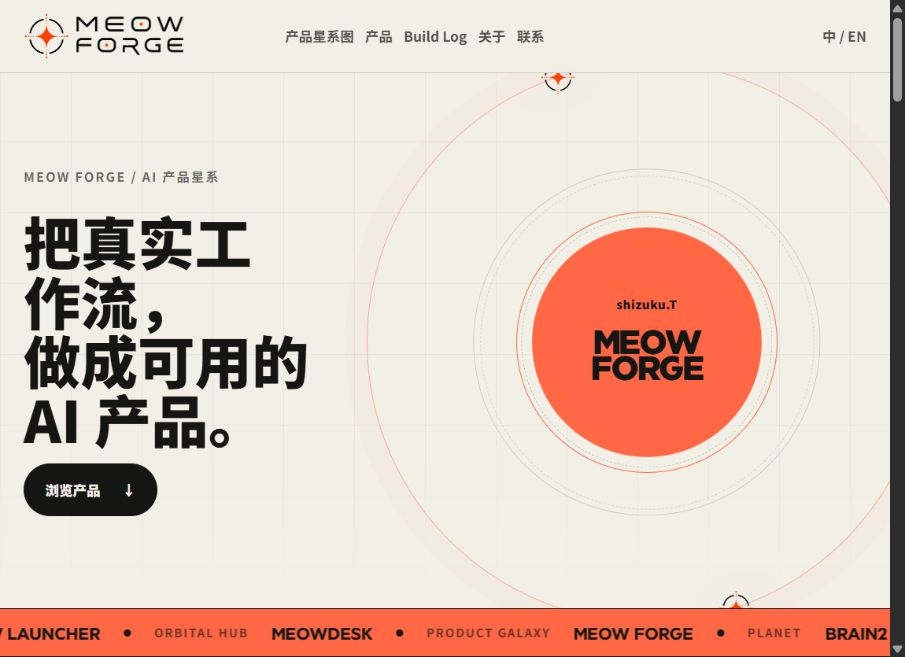

# Meow Forge

Meow 系列产品的独立展示站与产品化入口。

**[在线查看 Meow Forge](https://meow-forge-showcase.pages.dev/)** · 无需 GitHub 登录

## 为什么做 / 核心功能

系列产品各有自己的能力与交付边界，需要一个入口让访问者理解哪些是独立产品、哪些是集成环境、哪些仍在形成。Forge 保持原来的产品展示定位，不改造成专门的求职网站。

- 首页产品目录、卡片与交互展示。
- Galaxy Map：用节点、连接与状态区分产品关系。
- Brain2 / Meowdesk 说明页、About 与 Build Log。
- 中英文切换、响应式布局、GSAP 页面与滚动动画。

## 页面结构与实际技术

原生 HTML、CSS、JavaScript 多页面站；没有 React / Next / Vite，也不需要 Node 构建。GSAP / ScrollTrigger 作为本地前端资源使用。

```text
index.html       首页与产品目录
galaxy-map.html  产品关系图
brain2.html      Brain2 介绍
meowdesk.html    Meowdesk 介绍
about.html      关于
build-log.html  产品判断记录
script.js       目录数据、语言和交互
styles.css      布局与视觉
assets/         品牌、网站截图与第三方动画库
```

## 真实展示证据



截图来自真实公开站点，展示已删除旧首页说明段落的版本。当前界面仍保留原有产品状态与 Meowdesk、候选产品，不把“4个 GitHub 展示仓库”改写成网站只剩4个产品。

## 如何查看 / 当前状态

```powershell
python -m http.server 8875 --bind 127.0.0.1
# 打开 http://127.0.0.1:8875/
```

网站版本为 Prototype v0.8，已用 Cloudflare Pages Direct Upload 部署。当前 GitHub 源码补齐此前在正式源码上完成的名称同步、指定布局修复和首页说明删除。此轮只整理仓库与 README，**没有更新 Cloudflare Pages 生产部署、域名或页面内容**。源码公开后，GitHub 提交也不会自动部署至现有站点。

站点用于展示，支付、授权、表单与自动交付并未上线。国内多网络访问速度未经完整实测。实际检查见 [验证记录](docs/VALIDATION.md)。`preview*.html` 是保留的历史参考，不是当前网站入口。

## 我的职责与 AI Agent 协作

我（Shizuku）负责问题定义、需求分析、产品与交互设计、系统规则和业务逻辑、Prompt / Workflow、Agent 任务拆解，以及测试、问题复现、验收和发布迭代。代码主要由 Codex、Claude Code 等 Agent 协同生成、修复和维护；我组织推进并对产品边界和交付结果负责。这些产品原本就用于真实工作，不是为求职临时开发，也不表述为我独立手写的全栈系统。

## Meow 系列关系

- [Brain2](https://github.com/shizukuocean/brain2)：长期上下文、治理与受控 Agent 接入。
- [Dev Helper](https://github.com/shizukuocean/dev-helper-public)：规则、需求、问题证据与人工验收。
- [Meow Launcher](https://github.com/shizukuocean/meow-launcher-public)：产品目录与应用生命周期交付。
- [Meow Forge](https://github.com/shizukuocean/meow-forge-site)：独立产品展示入口；[在线查看](https://meow-forge-showcase.pages.dev/)。

## 公开与使用边界

这是可阅读、审查的真实源码展示。未为本项目自行选择 MIT、Apache 等开源许可证；公开可见不代表另行授予源码复用许可。第三方依赖仍按其各自许可证使用，见 [第三方说明](THIRD_PARTY_NOTICES.md)。这里不包含私人知识库、运行数据、Agent 凭据或未经验证的安装包。
